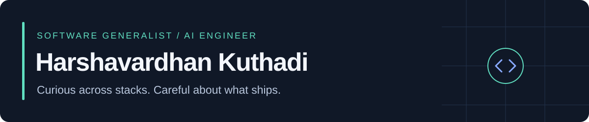

[Portfolio](https://harsha0602.github.io/Portfolio/) · [LinkedIn](https://www.linkedin.com/in/hkuthadi/) · [Email](mailto:hkuthadi@asu.edu) · Tempe, AZ

I like learning unfamiliar stacks and figuring out how things work. My background spans electronics, web and mobile apps, backend services, data pipelines, and machine learning. I choose tools to fit the problem and enjoy taking an idea through to something people can use.

AI is part of both what I build and how I work. I use it to explore ideas and work faster, then review the code, test the changes, and check what data and permissions the tools get. When I build AI features, I care about the surrounding software: useful tools, access checks, failure handling, and answers people can verify.

### What I'm working on

- **Product Engineer at Pretorin:** building Compliance Claw, the in-app assistant, and integrations that connect AI clients to the compliance platform.
- **Co-founded TappedIn:** built the mobile app and backend for a music discovery app with **1,000+ users**. [Open on the App Store](https://apps.apple.com/us/app/tappedin-music-scouting/id6749257951).
- **Previously AWS and o9 Solutions:** worked on data pipelines and enterprise planning software. M.S. in Software Engineering from Arizona State University.

### Selected projects

| Project | What to look at |
| :--- | :--- |
| [FluidFill](https://github.com/harsha0602/FluidFill) | Fill DOCX templates through a web form, with field extraction and reusable answers. **Next.js, TypeScript, FastAPI, PostgreSQL.** [Demo](https://youtu.be/StmRbEnZBgs) |
| [Clozyt](https://github.com/harsha0602/Clozyt-Recommendation-Algo) | A shopping prototype that uses image embeddings, vector search, and swipe feedback for recommendations. **Next.js, Python, Fashion-CLIP, Qdrant.** |
| [Realtime Study Rooms](https://github.com/harsha0602/Websockets_RTC) | Video calls and chat, plus a step-by-step tutorial for building the stack. **React, Node.js, WebSockets, WebRTC.** |
| [JobCity](https://github.com/harsha0602/JobCity) | A 3D job-search tracker with ingestion from five ATS sources, normalized listings, and authenticated APIs. **React Three Fiber, FastAPI, MongoDB.** |
| [Food Sage](https://github.com/harsha0602/foodSage) | A team project that extracts ingredients from food labels with image processing and OCR. **Python, OpenCV, Tesseract.** Visual AI Hackathon winner. |
| [FluxRate (Parking Simulation)](https://github.com/harsha0602/ACCPS-Sim) | Simulates entry and exit gates, occupancy-based pricing, and a full day of vehicle activity. **Java, Maven, Python, pandas.** |

Some linked repositories are forks of team projects. Their upstream repositories and contributors remain credited on GitHub.

### Tools I work with

**Languages:** Python, TypeScript, JavaScript, SQL, C#, Java, Scala, C++ 
**Apps and services:** React, React Native, Next.js, FastAPI, Node.js, .NET 
**Data, cloud, and AI:** PostgreSQL, AWS, Docker, PyTorch, vector search, MCP, OpenAI Agents SDK 
**Verification:** pytest, Playwright, Vitest, GitHub Actions

### About the contribution graph

My work at Pretorin is under [@harshavardhan-pretorin](https://github.com/harshavardhan-pretorin), including private repositories. The calendar on this profile reflects activity attributed to this account.

[More about me, my experience, and my projects →](https://harsha0602.github.io/Portfolio/)
